<a href="https://akinloluwa.dev">
  <picture>
    <source media="(prefers-color-scheme: dark)" srcset="https://raw.githubusercontent.com/pick-cee/pick-cee/main/assets/banner-dark.svg" />
    
  </picture>
</a>

  <samp>
    <a href="https://akinloluwa.dev">portfolio</a> ·
    <a href="https://www.linkedin.com/in/akinloluwa-olumuyide/">linkedin</a> ·
    <a href="mailto:akinloluwaolumuyide@gmail.com">email</a> ·
    <a href="https://cal.com/akinloluwa-olumuyide">book a call</a>
  </samp>

### Now

- At [Gethsemane Tech](https://www.gethsemanetech.io/), building [Klina](https://getklina.app) and [Brinlow](https://brinlow.com), and leading engineering at [metriq.studio](https://metriq.studio), our development studio.
- At Nestcoin ([Metaverse Magna](https://mvm.gg)), building backend services and real-time matchmaking for a live game platform.

<samp>Tools</samp>

 

| Area              | Tools                                                                                       |
| ----------------- | ------------------------------------------------------------------------------------------- |
| Languages         | TypeScript, JavaScript, Go, Python, C#, SQL                                                 |
| Frameworks        | Node.js, Express.js, NestJS, Next.js, Vue.js, Expo, Gin, Chi, GraphQL                       |
| Data              | PostgreSQL, MongoDB, MySQL, Redis, Supabase, PostGIS, pgvector                              |
| AI and automation | Claude API, Claude Agent SDK, MCP, n8n, Vapi, OpenAI embeddings, RAG, Apify, Firecrawl      |
| Tools and cloud   | Git, GitHub Actions, Docker, AWS S3, Vercel, Cloudflare, Postman, Swagger, BullMQ, RabbitMQ |

### My commits, eaten

  <picture>
    <source media="(prefers-color-scheme: dark)" srcset="https://raw.githubusercontent.com/pick-cee/pick-cee/output/github-snake-dark.svg" />
    <source media="(prefers-color-scheme: light)" srcset="https://raw.githubusercontent.com/pick-cee/pick-cee/output/github-snake.svg" />
    
  </picture>

